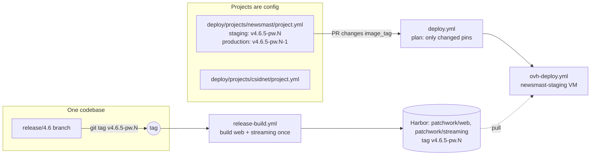

# Release and deploy flow (POC: newsmast.social on OVH)

This branch is a proof of concept for a new way to build and deploy all
Patchwork Mastodon projects. newsmast.social is the pilot.

- **Developers:** read [DEVELOPERS.md](DEVELOPERS.md). It covers releasing, rolling out, hotfixes, rollback and Mastodon upgrades.
- **DevOps:** read [DEVOPS.md](DEVOPS.md). It covers one-time setup (Harbor, GitHub environments, the VM, the runner), operations and cutover.

## Why change

Today each project is a set of long-lived branches (`<project>-<version>`,
`-staging`, `-production`). There are about 115 remote branches, and each
production branch carries its own copy of the OVH workflow. The problems:

- **The code barely differs, but the pipelines do.** Production branches differ from
  `patchwork-mastodon-4.6.5` in only 3 to 11 files, mostly the same Gemfile,
  Dockerfile and `compose_form` changes. Meanwhile the copied workflows have
  drifted: `COMPOSE_FILE` vs `COMPOSE_SOURCE_FILE`, different permissions, and
  `docker compose down` (downtime) on mo-me only.
- **The same code is built over and over.** Each project builds its own image
  from almost the same code.
- **Nothing records what is live.** Image tags are changed with `sed` on the runner
  and never committed. Rollback means guessing.
- **Migrations are tied to startup.** They run inside the web container's start
  command; if they fail, the site is down.
- **Upgrades grow with every project.** A Mastodon upgrade means new branches
  for every project, with the project commits applied again by hand.

## The new model

1. **One codebase per Mastodon line.** Shared changes are made once.
2. **One image per release.** A tag `v4.6.5-pw.N` builds `web` and `streaming`
   once and pushes them to a shared Harbor project.
3. **A project is a folder in `deploy/projects/`, not a branch.** Each environment pins the
   image tag it runs. Git history shows what runs where, and who changed it.
4. **A deploy is a PR that changes a pin.** Merging the PR deploys only the
   environments whose pin changed. Rolling out to specific projects means
   changing only those pins (see [DEVELOPERS.md](DEVELOPERS.md#rolling-out-to-specific-projects)).
5. **One reusable deploy workflow.** It pulls, runs pre-deploy migrations, swaps
   the containers with no `down`, runs a smoke test, rolls back automatically on
   failure, then runs post-deploy migrations. The last 5 releases stay on the VM.

## What is in this branch

The branch is based on `newsmast-4.6.5-production`, so the image built from it
is today's newsmast code. The POC is **one commit that only adds new files**:
existing workflows (including the AWS deploys) are unchanged.

| File                                   | Purpose                                                                                                   |
| -------------------------------------- | --------------------------------------------------------------------------------------------------------- |
| `.github/workflows/release-build.yml`  | Builds `web` and `streaming` once per tag (`v*.*.*-pw.*`) or per manual run (`sha-<commit>`)              |
| `.github/workflows/deploy.yml`         | Dispatcher: plans which project/environment pairs to deploy, then calls the reusable workflow as a matrix |
| `.github/workflows/ovh-deploy.yml`     | Reusable: deploys one project/environment on its VM through a self-hosted runner                          |
| `deploy/projects/_defaults.yml`        | Defaults for every project: shared registry, host paths, resources                                        |
| `deploy/projects/newsmast/project.yml` | The newsmast project: resources, Firebase path, staging and production pins                               |
| `deploy/compose/mastodon.yml`          | One compose file for every OVH project, filled in from the generated `.env`                               |
| `deploy/bin/plan-deploy`               | Works out the deploy matrix (used by CI; can be run locally to preview)                                   |
| `deploy/bin/rollout`                   | Moves pins for a selection of projects (`newsmast`, `wave:1`, `tag:small`, ...)                           |
| `deploy/bin/ovh-deploy.sh`             | Runs on the VM: `deploy`, `rollback [release]`, `status`                                                  |
| `deploy/lib/patchwork_deploy.rb`       | Shared logic (plain Ruby stdlib)                                                                          |
| `deploy/test/patchwork_deploy_test.rb` | Unit tests: `ruby deploy/test/patchwork_deploy_test.rb`                                                   |

## POC status and placeholders

Verified locally:

- the unit tests pass (10 tests);
- `actionlint` passes on the three workflows;
- `docker compose config` renders the compose file with newsmast's generated `.env`;
- `ovh-deploy.sh` deploy, automatic rollback and manual rollback work against a stubbed docker;
- `rollout` and the push-based plan only pick up the changed pin.

Nothing has run on GitHub or on a VM yet.

Before the first real run, DevOps must fill in these values (all marked `CHANGE_ME`):

| What                                                                                       | Where                                                           |
| ------------------------------------------------------------------------------------------ | --------------------------------------------------------------- |
| Harbor project `patchwork` plus robots `release-push` and `newsmast-staging-pull`          | Harbor, see [DEVOPS.md](DEVOPS.md#1-harbor)                     |
| GitHub environments `newsmast-staging` / `newsmast-production` with `HARBOR_PULL_PASSWORD` | GitHub settings                                                 |
| Secret `RELEASE_HARBOR_PASSWORD`                                                           | GitHub (organization secret; the repo is at the 100-secret cap) |
| Staging VM with a runner labelled `newsmast-staging`                                       | OVH plus GitHub runners                                         |
| Staging hostname (`public_url`)                                                            | `deploy/projects/newsmast/project.yml`                          |

newsmast production stays on AWS ECS. Its OVH environment is `enabled: false`
until the cutover in [DEVOPS.md](DEVOPS.md#cutover-of-newsmast-production-from-aws).

> **GitHub limitation:** "Run workflow" (`workflow_dispatch`) only appears for
> workflows that exist on the default branch. During the POC, either copy the
> three workflow files to `main` (they only act on this branch's config), or
> deploy through pin changes (push), which works from this branch alone.

## Adopting it for every project

1. **Settle the shared code.** Move the shared differences into the base: the
   `newsmast_mastodon` gem branch, the Dockerfile changes and `compose_form`.
   Create `release/4.6` from it. Anything that still has to differ per project
   becomes config (ENV or engine settings), or a build variant as a last resort.
2. **Bring the POC over.** Cherry-pick the POC commit onto `release/4.6` and `main`.
   Change the `branches:` filter in `deploy.yml` to `main`.
3. **Move the OVH projects one at a time.** For each of csidnet, democracy-book-club,
   mo-me, nithecs, lhumanite-social, ouest-france-social and pouetfrance-social:
   add `deploy/projects/<name>/project.yml`, create its environment and pull
   robot, then deploy once. `ovh-deploy.sh` uses the same compose project name
   (`mastodon`) and the same upload volume as the old compose files, so it takes
   over the running containers. Then delete that project's old
   `build-push-*-ovh-harbor.yml` workflow.
4. **Then the AWS projects,** one cutover at a time (newsmast first, as the pilot).
5. **Archive old branches.** Turn the old `<project>-<version>*` branches into
   tags, then delete them.
